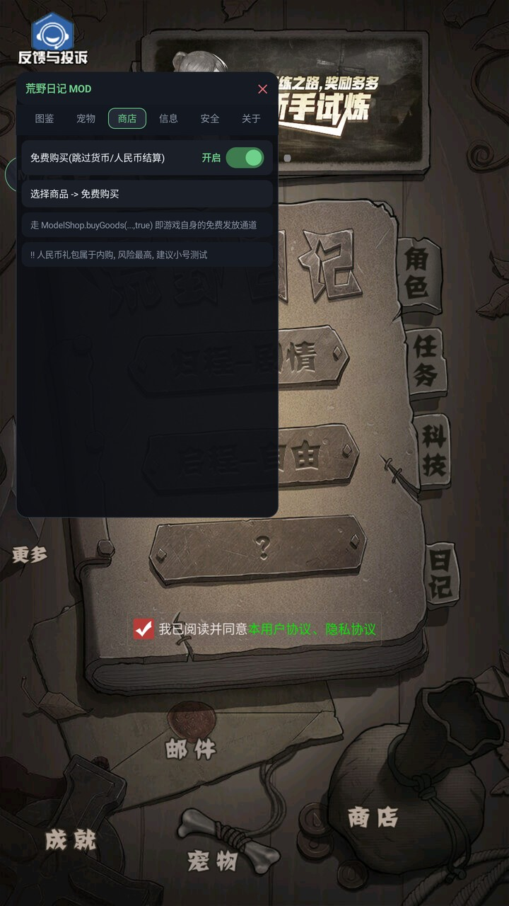

# 荒野日记 (二代) 直装 MOD

《荒野日记》(二代) OPPO 渠道服 (`com.dygame.hyrj.nearme.gamecenter`) 的**直装 MOD**:
把 MOD 直接打包进 APK, 安装后启动游戏即自动加载, 无需 Root、无需框架(Xposed/VirtualXposed)、无需每次倒腾脚本。

> 上一代项目: [hyqs-island-mod](https://github.com/qpalzm2332933171-droid/hyqs-island-mod) (《荒野日记:孤岛》)
> 本项目沿用同一套思路, 但**封号/反外挂体系完全不同**, 已重新逆向并逐条针对处理, 详见下文。

**最新版本: `v1.0.6`** — 直装 APK 下载见 [**Releases**](https://github.com/qpalzm2332933171-droid/hyrj2-mod/releases)
(无需 Root / Xposed; 与官方版签名不同, 换装前先卸载官方版, 云存档随账号恢复)。

---

## 一、特性

### 1. 防封号 (本项目重点)

二代的反外挂与上代差异很大, **核心是 `HYCommon.setCheat()` + `HYHttpMgr.clientlog()` 的位掩码上报链**。
本 MOD 在启动时(游戏主循环起来前)全部挂钩:

| # | 机制 | 位置 | 处理 |
|---|---|---|---|
| 1 | `HYHttpMgr.clientlog(type,...)` — 一切作弊上报的总出口, 每次调用先 `setCheat` 再上传 | 51121 | **挂钩后直接 return**, 不上报也不写标记 |
| 2 | `base.cheat` 位掩码 (account_cheat=1 / modify_achieve=2 / modify_mission=4 / cheat_tick=8 / cheat_enprice=16 / cheat_deprice=32) | `HYCommon.setCheat` 44102 | 函数置空 + **启动时把已有标记清零并 trySave** |
| 3 | `HYHttpMgr.logError` 上传 REPORT_ERROR / 4015 | 50506 附近 | 关键字过滤(REPORT_ERROR / 4015 / cheat) |
| 4 | `SceneMain._checkMainJs()` — 比对 main.js 的 md5 (`7d6dfe230ee6e39291c6738689b562fe`), 不符 → `clientlog("account_cheat")` → 4015-1 弹窗 | 122209 | 覆写为恒 `true` |
| 5 | `HYCommon.sealTip(t)` — 弹 `4015-t` 并递归重弹 | 44083 | 置空 |
| 6 | `alertError` 的 4015/4015_1 弹窗 | 42878 | `HYCommon.alert` 过滤标题含 4015 的弹窗 |
| 7 | `window.DDREPORT` — 物品数据本地一致性校验失败上报 | 33354 | 改道(只打日志, 不上传) |
| 8 | 热更会覆盖 `project.jsc` → MOD 失效 | `checkUpdateInfo` 50506 | 伪造 "无更新" |
| 9 | 物品操作用手写键值会触发 `_checkItem` 一致性上报 | 46192 | **一律走游戏原生 `HYCommon.changeItemNum()`, 与正常获得完全一致** |

> 设计原则: **优先 hook 返回值(纯本地, 完全不上传), 其次走游戏原生接口**, 绝不手写存档键。
> 另: 用 `ModProvider` (ContentProvider) 在**进程启动的最早期**把 MOD 版 `project.jsc` 覆盖回热更目录,
> 保证即使服务器推了新热更也被本地 MOD 版覆盖, 且无需 Root 权限(同包名, 目录可写)。

### 2. 菜单功能

原生 Android 悬浮球 + 面板(可拖动), 由 `mod/java/com/hymod/ModMenu.java` 绘制, JS 侧通过
`jsb.reflection.callStaticMethod("com/hymod/ModBridge", ...)` 下发菜单 JSON。

| 分组 | 功能 | 状态 |
|---|---|---|
| 物品 | 物品选择器 (382 项带图标, 搜索/多选) → 发放到背包 / 仓库 | ✅ 已实测 |
| 物品 | 金币 / 银币 +99999 (走原生邮件领取通道) / 千元以上不归零 | ✅ 已实测 |
| 物品 | 一键背包搬仓库 / 清空背包 / 堆叠整理 (装备·药剂已改为可堆叠) | ✅ 已实测 |
| 物品 | 仓库 / 背包容量修改 (填数值或点选, 0=恢复原生; 数值=当前总重量参考) | ✅ 已实测 |
| 角色 | 角色全解锁 / 单角色选择解锁 / 皮肤切换 | ✅ 已实测 |
| 状态 | 分项回满 (饱食/健康/精力) / 设置 HP / 设置 HP 上限 (支持多角色) | ✅ 已实测 |
| 状态 | 锁四维 (饥饿·健康·精神·水疫) / 移速 1~10 倍 (精确 3.0 倍验证) | ✅ 已实测 |
| 战斗 | 无敌 + 一击必杀 (只作用于我方, PVP 夜袭敌方不受影响; **真实战斗实测**) | ✅ 已实测 |
| 科技 | 四分类全解锁 (工具/医药/厨房/负重) + 真实效果加成 + 进度栏同步 | ✅ 已实测 |
| 建筑 | 建筑选择器 (带名字) / 全建筑解锁 + 满级 / 一键修复 / 越界等级自愈 (修迷宫出口卡关) | ✅ 已实测 |
| 成就 | 一键完成 / 成就选择器 (63 条) | ✅ 已实测 |
| 图鉴 | 图鉴全解锁 (5 组 256 项) | ✅ 已实测 |
| 宠物 | 解锁宠物系统 / 宠物选择器 (15 只带名字图标 → 兽栏宠室) | ✅ 已实测 |
| 商店 | 免费购买 + 面板打不开修复 (缓存自愈 + 兜底入口) | ✅ 已实测 |
| 关于 | 信息查询 (世界信息 / 环境检测) 并入; 菜单 12 页 | ✅ 已实测 |
| 安全 | 拦截作弊上报 / 拦截热更 / 自动存档开关 / 清除作弊标记 / 首选项重启后真实生效 | ✅ 已实测 |

### 3. 截图

| 主界面 (悬浮球) | 原生菜单 (12 页) | 真实战斗 (无敌 + 一击必杀) |
|---|---|---|
|  |  |  |

---

## 二、原理与工程结构

```
目标 APK (0.0.7.0)  assets/src/project.jsc
        │  xxtea 解密 (key 见 mod/tools/jsc.py)
        ▼
game-source/project.hot.dec.js   ← 基线(跟着设备热更版 0.0.8.070501 走)
        │  + mod/js/mod_native.js   (MOD 注入层, 追加在文件末尾)
        ▼
   project.mod.js ── xxtea 加密 ──▶ project.jsc ──▶ 覆盖 APK 内的 assets/src/project.jsc
                                                     同时由 ModProvider 在启动时覆盖热更目录
```

- **JS 层** `mod/js/mod_native.js`: 用全局 `require("HYData")` 拿游戏模块(二代不挂 `window`),
  负责安全层挂钩、功能实现、菜单 JSON 下发。
- **Java 层** `mod/java/com/hymod/`:
  - `ModProvider.java` — ContentProvider, 借系统启动时机加载 dex / 覆盖热更 jsc / 挂载悬浮球;
  - `ModMenu.java` — 原生悬浮球与面板(文本/开关/滑条/输入框/选择器/按钮);
  - `ModBridge.java` — `@JavascriptInterface` 之外的静态桥, 供 JS 反射调用。
- **构建工具** `mod/tools/`: 纯 Python, 负责解密/打包 jsc、编译 dex、打补丁 manifest、zipalign + 签名。

## 三、构建

前置: Python 3 (含 `xxtea`)、JDK 8+、Android SDK (build-tools / platforms)、`apktool.jar`。

```bash
# 1) 解包目标渠道 APK (保留 dex)
java -jar work/apktool.jar d -s -f 荒野日记_0.0.7.0.apk -o work/apk_dec

# 2) 解密游戏脚本, 并以设备热更版为基线
python mod/tools/decrypt_apk_js.py        # -> game-source/project.dec.js
cp game-source/project.hot.dec.js game-source/project.mod.base.js

# 3) 编译 Java 层 -> classes.dex
python mod/tools/build_dex.py

# 4) 给 AndroidManifest.xml 插入 ModProvider
python mod/tools/patch_manifest.py

# 5) 一键打包
python mod/tools/build_apk.py             # -> dist/荒野日记_MOD.apk
```

调试 JS 时可以跳过打包(秒级迭代): `python mod/tools/build_mod.py --check --deploy`,
再把 `work/build/project.jsc` push 到设备热更目录 `.../files/<hash>/src/project.jsc` 即可。

## 四、目录结构

```
mod/js/mod_native.js          MOD 注入层 (安全层 + 菜单 + 功能)
mod/java/com/hymod/           Java 原生悬浮菜单 / ModBridge / ModProvider
mod/tools/                    构建与分析脚本
game-source/                  解密出的游戏脚本与配置表 (版权归游戏方, 仅学习用)
docs/analysis-scripts/        逆向过程中用到的检索/分析脚本 (可复现全部结论)
PROGRESS.md                   开发进度记录 (仅本地保留, 不进仓库)
NOTICE.md                     版权与使用声明
```

## 五、已验证

- [x] 设备: MuMu 模拟器 (Android 12, x86) — MOD 版 APK 直装启动, 悬浮球出现, 数据未丢
- [x] 安全层全量挂钩成功, 无 4015 弹窗
- [x] 物品发放 / 货币发放走原生接口, 存档一致
- [x] `ModProvider` 启动自动覆盖热更目录 `project.jsc`
- [x] 全功能实机验证: 物品/货币/科技/状态/图鉴/成就/角色/宠物/商店/建筑/皮肤/锁四维/移速
- [x] 战斗 hook 三重拦截 (战斗内 `takeDamage` + 结算写回 `updateState` + 宠物 `setHpRelative`),
      mock 回归 + **真实战斗 0 掉血**; 一击必杀实拍 11998 伤害
- [x] v1.0.4 完整重打包 (`build_dex` + `build_apk`) + `install -r` + 开机回归通过
- [x] v1.0.5: 阶段 8 十七项修复/细化实机回归 (邮件货币通道 / 商店重开自愈 / 装备堆叠 /
      单角色解锁 / 分项状态+HP / 科技四分类·真加成·进度同步 / 建筑选择器 / 成就 /
      宠物选择器 / 菜单整理), 面板科技进度拦截原生回写稳定 156/156
- [x] v1.0.6: 迷宫出口卡关修复 (建筑越界等级自愈 + 时长接口防护) / 仓库·背包容量修改 /
      "保存功能首选项" 重启后真实生效; 完整重打包 + `install -r` 开机回归通过

## 六、免责声明

本项目仅供**逆向工程与安全研究学习**使用。修改客户端与存档可能违反游戏用户协议并导致账号受限,
请勿在充值账号上使用; 由此产生的一切后果由使用者自行承担。详见 [NOTICE.md](NOTICE.md)。
